# Visual Question Answering (VQA) on VQA v2.0 Dataset

This repository contains the reproduction, implementation, and comparative evaluation of three multimodal architectures for the **Visual Question Answering (VQA v2.0)** challenge on MS COCO 2014:

1. **Classic Baseline (Antol et al. Reproduction)**: VGG16/19 image features fused with a 2-layer LSTM question encoder via element-wise pointwise multiplication.
2. **Simple Multimodal Baseline (ResNet-50 + BERT Concat)**: ResNet-50 visual features concatenated with pooled frozen BERT (`bert-base-uncased`) representations.
3. **Cross-Modal Transformer Encoder (CME)**: A 2-layer Cross-Modal Transformer Encoder that performs token-level joint self-attention across ResNet visual tokens and BERT word tokens with modality-type and positional embeddings.
4. **Zero-Shot CLIP Baseline**: Evaluation using `openai/clip-vit-base-patch32` contrastive alignment.

---

## 📊 Benchmark & Evaluation Results

### 1. Official VQA v2.0 Evaluation Metric (Baseline Model)

Evaluated on the MS COCO `val2014` split using the official VQA evaluation harness (`vqaEvalDemo.py`) in [`Baseline_result.ipynb`](file:///home/oracle/code/2014_vqa_challenge/Baseline_result.ipynb):

| Metric | Accuracy (%) | Description |
| :--- | :---: | :--- |
| **Overall Accuracy** | **46.52%** | Standard 10-annotator agreement metric |
| **Yes / No** | **67.93%** | Binary questions (*is this*, *are there*, *can you*) |
| **Other** | **34.06%** | Open-ended (*what*, *where*, *who*, *why*) |
| **Number** | **32.03%** | Counting questions (*how many*) |

#### Accuracy by Question Type (Selected Highlights)

| Top Performing Categories | Acc (%) | Challenging Categories | Acc (%) |
| :--- | :---: | :--- | :---: |
| **What room is** | 78.57% | **What number is** | 1.66% |
| **Could** | 77.31% | **What is the name** | 5.46% |
| **What sport is** | 75.98% | **Why** | 11.14% |
| **Is it** | 70.56% | **What does the** | 12.68% |
| **Does this** | 68.45% | **Why is the** | 12.92% |
| **Was** | 68.28% | **What time** | 13.80% |

---

### 2. Comparative Benchmark (Controlled Validation Subset, N = 200)

Evaluated under identical conditions across 1,000 candidate answer classes in [`experiments.ipynb`](file:///home/oracle/code/2014_vqa_challenge/experiments.ipynb):

| Model Architecture | Vision Backbone | Text Backbone | Fusion Mechanism | Top-1 Accuracy (%) | Epoch 10 Loss |
| :--- | :--- | :--- | :--- | :---: | :---: |
| **Cross-Modal Encoder (CME)** | ResNet-50 (2048-d) | BERT-base (768-d) | 2-Layer Transformer Self-Attention | **45.00%** | **1.5397** |
| **Simple Concat** | ResNet-50 (2048-d) | BERT-base (768-d) | Feature Concatenation $[v; q]$ | **38.50%** | **1.9472** |
| **Zero-Shot CLIP** | ViT-B/32 | CLIP Text Enc | Cosine similarity ranking | **0.00%** | N/A |

```text
Validation Top-1 Accuracy Comparison (N = 200)
-----------------------------------------------------------
Cross-Modal Encoder (CME) : [█████████████████████   ] 45.00%
Simple Concat (ResNet+BERT) : [█████████████████       ] 38.50%
Zero-Shot CLIP (ViT-B/32)   : [                        ]  0.00%
-----------------------------------------------------------
```

---

## 🏗️ Model Architectures

```mermaid
flowchart TD
    subgraph Baseline["1. Classic Baseline (VGG + LSTM)"]
        A1["Image (224x224)"] --> B1["VGG16/19 (fc7: 4096-d)"] --> C1["Linear (1024-d) + L2 Norm"]
        A2["Question Tokens"] --> B2["Embedding (300-d)"] --> C2["2-Layer LSTM (2048-d)"] --> D2["Linear (1024-d) + Tanh"]
        C1 --> E1["Element-wise Multiplication (⊗)"]
        D2 --> E1
        E1 --> F1["Dropout + Tanh + MLP Classifier"]
    end

    subgraph CME["2. Cross-Modal Encoder (ResNet + BERT + Transformer)"]
        M1["ResNet-50 Features (2048-d)"] --> N1["Vision Proj (d=512) + Type Emb 0"]
        M2["BERT Tokens (768-d)"] --> N2["Text Proj (d=512) + Type Emb 1"]
        N1 --> O1["Concatenate Sequence [v; t] (1+L tokens)"]
        N2 --> O1
        O1 --> P1["Add Positional Embeddings"]
        P1 --> Q1["2-Layer Transformer Encoder (8 heads, d=512)"]
        Q1 --> R1["Mask-aware Mean Pooling"]
        R1 --> S1["MLP Head -> Answer Classes (1000)"]
    end
```



### Architectural Details

1. **Classic Baseline (`BaseLineVQA`)**:
   - **Image Encoder**: Pretrained VGG-19, fc7 feature extraction (4096-d) projected to 1024-d, L2 normalized.
   - **Text Encoder**: Word embedding layer (300-d) feeding a 2-layer LSTM (hidden size 512). The hidden ($h$) and cell ($c$) states of both layers are concatenated ($2 \times 2 \times 512 = 2048$-d) and projected to 1024-d with Tanh activation.
   - **Fusion**: Pointwise element-wise multiplication ($\mathbf{v} \odot \mathbf{q}$) passed through a 2-stage MLP with 50% dropout and Tanh non-linearities.

2. **Simple Concat Model (`SimpleVQA`)**:
   - **Image Features**: Precomputed global average-pooled ResNet-50 features ($2048$-d).
   - **Text Features**: Pretrained frozen BERT (`bert-base-uncased`) `pooler_output` ($768$-d).
   - **Fusion**: Linear concatenation resulting in a $2816$-d joint vector, directly classified into the top-1000 answer categories.

3. **Cross-Modal Encoder VQA (`CrossModalEncoderVQA`)**:
   - Projects both modalities to a common latent dimension $d = 512$.
   - Prepends vision tokens with a learned modality-type embedding ($0$) and text tokens with modality-type embedding ($1$).
   - Passes the combined token sequence through a **2-layer Transformer Encoder** ($8$ heads, GELU activation, dropout $0.2$).
   - Uses mask-aware mean pooling over valid tokens followed by a LayerNorm and classification head.
   - **Result**: Yields a **+6.50% gain** over simple concatenation due to token-level cross-attention.

---

## 📈 Training Convergence

Training logs over 10 epochs on VQA v2.0 training data:

| Epoch | Simple Concat Avg Loss | Cross-Modal Encoder (CME) Avg Loss |
| :---: | :---: | :---: |
| 1 | 3.2258 | 2.0848 |
| 2 | 2.6728 | 1.7524 |
| 3 | 2.4592 | 1.6794 |
| 4 | 2.3236 | 1.6388 |
| 5 | 2.2234 | 1.6119 |
| 6 | 2.1454 | 1.5876 |
| 7 | 2.0843 | 1.5695 |
| 8 | 2.0302 | 1.5492 |
| 9 | 1.9873 | 1.5361 |
| 10 | **1.9472** | **1.5397** |

---

## 📁 Repository Structure

```text
2014_vqa_challenge/
├── README.md               # Project documentation, architectures, and benchmark results
├── Baseline_result.ipynb   # Official VQA evaluation harness & question-type accuracy breakdown
├── experiments.ipynb       # Concat vs. CME vs. CLIP training, loss curves, and evaluation
├── revamp-vqa.ipynb        # Data preprocessing, vocabulary creation, and pipeline implementation
└── training_process.txt    # Kaggle and Google Colab cloud training notebook links
```

---

## 🔗 Cloud Training Notebooks

Training sessions and cloud execution runs are documented in [`training_process.txt`](file:///home/oracle/code/2014_vqa_challenge/training_process.txt):

- **Baseline Model Training**: [Kaggle Notebook (revamp-vqa)](https://www.kaggle.com/code/exusiaiap/revamp-vqa)
- **CME Model Training**: [Kaggle Notebook (morizz)](https://www.kaggle.com/code/exusiaiap/morizz)
- **Simple Concat Model Training**: [Kaggle Notebook (simplevqa)](https://www.kaggle.com/code/kristiko/simplevqa)
- **Joint Evaluation Notebook**: [Kaggle Notebook (re-vqa)](https://www.kaggle.com/code/kristiko/re-vqa) | [Google Colab Run](https://colab.research.google.com/drive/1oAh_-15DI-0gYDcluAcooF9EamUh4QQT?usp=sharing)

---

## 🚀 Setup & Usage

### 1. Requirements

```bash
pip install torch torchvision transformers torchmetrics matplotlib pillow tqdm
```

### 2. Dataset Setup

Download the MS COCO 2014 images and VQA v2.0 annotations:
- `train2014` and `val2014` image directories.
- `v2_OpenEnded_mscoco_train2014_questions.json` and annotations.
- `v2_OpenEnded_mscoco_val2014_questions.json` and annotations.

### 3. Running CME Evaluation

```python
import torch
from transformers import BertTokenizer
from experiments import CrossModalEncoderVQA, evaluate_vqa, VQAv2Dataset

device = torch.device('cuda' if torch.cuda.is_available() else 'cpu')
tokenizer = BertTokenizer.from_pretrained('bert-base-uncased')

model = CrossModalEncoderVQA(num_answers=1000).to(device)
# Load checkpoint: model.load_state_dict(torch.load("cme_model.pt"))
```
